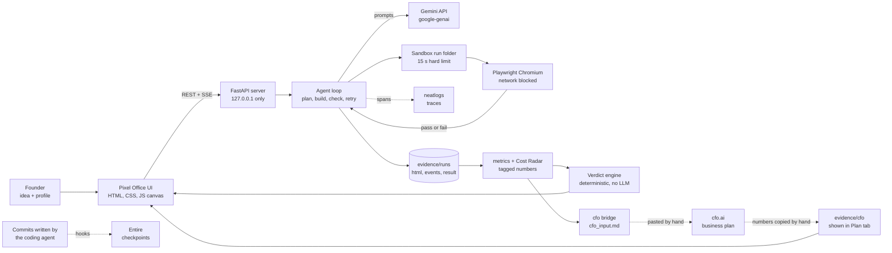
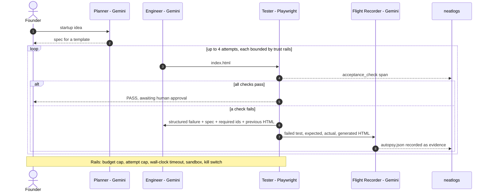
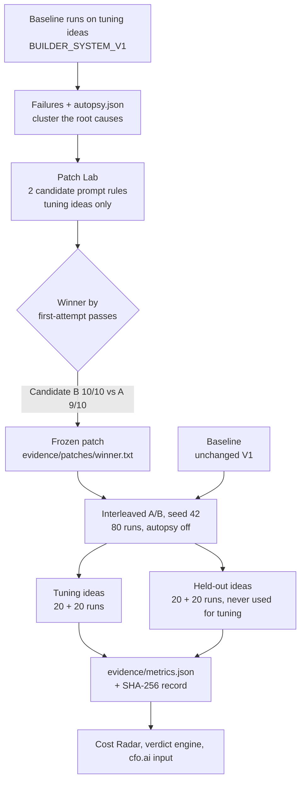
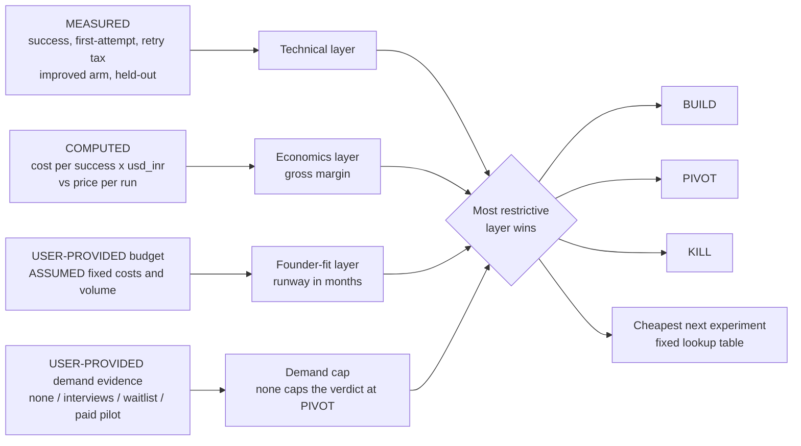
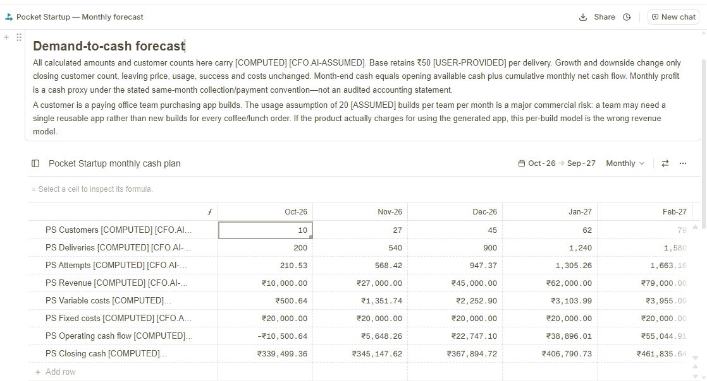
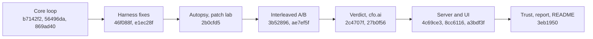

<div align="center">

# Pocket Startup

### Should you build it?

**An agent that builds your idea as a tiny app, breaks it in a real browser, diagnoses its own failures, proves the fix on ideas it never saw, and says BUILD, PIVOT or KILL. Every claim links to evidence.**

[](https://www.python.org/)
[](https://fastapi.tiangolo.com/)
[](https://playwright.dev/python/)
[](https://ai.google.dev/)
[](https://neatlogs.com/)
[](https://entire.io/)
[](https://cfo.ai/)
[](#tests)
[](#the-ui)
[](LICENSE)

`Python 3.12` · `FastAPI` · `Server-Sent Events` · `Playwright` · `Gemini` · `neatlogs` · `Entire` · `cfo.ai` · `Vanilla JS + Canvas` · `pytest`

**neatHack 2026** · Team **hollanov** · Built by **Purvanshi Khandelwal**

[Results](#results-at-a-glance) · [Verify in 5 minutes](#verify-in-5-minutes) · [How it works](#how-it-works) · [The experiment](#the-experiment) · [Verdict engine](#the-verdict-engine) · [Quick start](#quick-start) · [Honesty notes](#honesty-notes-and-limitations)

</div>

<!-- Demo video: paste the link here at submission time, for example:
> **Demo video (3 min):** https://... -->

---

## What it is

Agents can build things now. Nobody tells you which things deserve building.

Pocket Startup takes one sentence, a startup idea, and runs a bounded loop:

1. **Plan.** A planner turns the idea into a spec for one of a small set of app templates.
2. **Build.** An engineer prompt produces a single-file web app.
3. **Break.** A real browser (Playwright, headless Chromium, network blocked) runs scripted acceptance tests. **Pass or fail is decided by code, never by an LLM.**
4. **Diagnose.** When a check fails, the failure is traced in neatlogs and a Flight Recorder call writes a structured diagnosis (`autopsy.json`).
5. **Retry or stop.** The model gets the spec, required ids, the previous HTML and the structured failure, up to four attempts. Trust rails (budget, attempt cap, timeout, sandbox, kill switch) bound the run, and a human approval gate sits at the end.
6. **Prove.** A patch lab turns failure patterns into prompt rules, and an interleaved A/B compares baseline against improved on tuning ideas **and on held-out ideas the patch was never tuned on**.
7. **Decide.** A deterministic, four-layer verdict engine combines measured results, cost, the founder's budget and demand evidence into **BUILD, PIVOT or KILL**, with every reason tagged by where its number came from.
8. **Plan the business.** cfo.ai plans pricing, unit economics, scenarios and runway from the measured costs.

> **A passing browser test is not demand.** Pocket Startup can say whether a tiny app can be built reliably and what it costs. It cannot tell you that customers will pay. The verdict engine caps the result at **PIVOT** until the founder supplies demand evidence.

---

## Results at a glance

Headline experiment: **80 interleaved runs, 20 per cell**, seed 42, model `gemini-3.5-flash-lite`, temperature 0.2, autopsy disabled. Frozen in [`evidence/metrics.json`](evidence/metrics.json) (SHA-256 recorded in [`evidence/ab/metrics.sha256`](evidence/ab/metrics.sha256)).

| | Baseline | Improved (one prompt rule) |
|---|---:|---:|
| **First-attempt passes, tuning ideas** | 1 / 20 | **20 / 20** |
| **First-attempt passes, held-out ideas** | 1 / 20 | **16 / 20** |
| **First-attempt passes, combined** | 2 / 40 | **36 / 40** |
| Eventual success, combined | 35 / 40 | 39 / 40 (**not statistically significant**) |
| Cost per successful build, combined | $0.016808 | **$0.006863** (−59%) |
| Median latency, combined | 18.98 s | 10.22 s |
| Average attempts, combined | 2.30 | 1.23 |

First-attempt gains are significant (Fisher exact, p < 0.001, indicative because runs are treated as independent). The eventual-success difference is not (held-out 15/20 vs 19/20, p ≈ 0.18; combined 35/40 vs 39/40, p ≈ 0.20).

**What this does not show:** that the autopsy itself causes the improvement (it was disabled in the A/B, which compares builder prompts), that the rule transfers to other templates (held-out ideas use the same template), or that the remaining failures are solved (see [the limitation](#known-limitation-idea-vs-template-mismatch)).

---

## Verify in 5 minutes

| Claim | Where to verify | Command or file |
|---|---|---|
| The agent builds and checks apps end to end | 161+ real run folders: `index.html`, `events.json`, `result.json` | `evidence/runs/` |
| Pass/fail comes from code | Playwright acceptance suite and fixtures (good and bad pages) | `agent/checks.py`, `tests/fixtures/` |
| Failures are diagnosed | One `autopsy.json` per failed run | `evidence/runs/20261011-043610-3f24/autopsy.json` |
| A fix improved first-attempt passes | Per-cell counts, run IDs, Fisher p-values, Wilson intervals | `evidence/metrics.json`, `evidence/cost_radar.md`, `evidence/ab/README.md` |
| The result is frozen | SHA-256 of `metrics.json` equals the recorded hash | `Get-FileHash evidence/metrics.json -Algorithm SHA256` vs `evidence/ab/metrics.sha256` |
| The fix holds on unseen ideas | Held-out cells and idea lists | `experiments/ideas.py`, `evidence/metrics.json` |
| Harness bugs were found and fixed before the headline run | Dated change log | `evidence/CHECK_CHANGELOG.md`, `evidence/analysis/` |
| Cost per success | Computed from measured tokens at list price | `evidence/cost_radar.md`, `agent/llm.py` (`PRICES`) |
| Entire checkpoints on agent-written commits | Commit trailers and the Entire mirror | `git log --format="%h %s%n%b"`, `entire checkpoint list`, `entire.io/gh/Pierce05/pocket-startup` |
| neatlogs traces | Screenshots and index (private workspace) | `evidence/traces/index.md` |
| cfo.ai plan from measured data | Input file, screenshots, hand-copied numbers | `evidence/cfo/` |
| The verdict is deterministic | Same inputs, same verdict; no LLM calls | `python verdict.py --founder a`, `python verdict.py --founder b` |
| Trust rails work | Rails computed from `result.json`, failed runs keep the cap that fired | UI **Trust** tab, `agent/rails.py` |
| Every number is labeled | `MEASURED`, `COMPUTED`, `USER-PROVIDED`, `ASSUMED`, `CONFIG`, `MOCK` | `evidence/ledger.json`, UI **Evidence** tab |
| It all runs | Unit and integration tests | `python -m pytest -q` |

---

## How it works

### System overview



### One run, step by step



### Trust rails

The agent can be left alone because it cannot run off. Each rail is computed from the run's `result.json` and shown in the **Trust** tab as FIRED, NOT FIRED or NOT TESTED.

| Rail | What it does |
|---|---|
| Budget cap | Stops a run when its computed cost passes the cap (the **Tiny budget demo** triggers it on purpose) |
| Attempt cap | Four build attempts at most. It fired on real runs such as `20261011-090412-05dc` and `20261011-091315-a55d` |
| Wall-clock timeout | The whole browser check is bounded (15 s), with short per-action timeouts |
| Sandbox | Playwright blocks the network. The generated app is previewed in an iframe with `sandbox` and no `allow-same-origin` |
| Kill switch | `POST /api/runs/{id}/kill` stops a live run |
| Human approval gate | `POST /api/runs/{id}/approve` is refused (HTTP 409) unless the run passed. Approval is written to a new file, never into the run's `result.json` |

---

## The experiment



**The winning rule** (frozen in `evidence/patches/winner.txt`, appended to the baseline builder prompt):

> Before performing any calculation, check every numeric input. Verify that the bill is zero or greater, the tip percentage is zero or greater, and the number of people is a whole number greater than zero. On any invalid input, show an error message in #error and do not display anything in #result.

It contains no test names, no example values and only ids from the shared spec. It was written from failure clusters on the **tuning** ideas. The held-out ideas were never shown to the autopsy or the patch lab.

### Detailed results

| Cohort | Arm | First-attempt passes (95% Wilson) | Eventual success | Avg attempts | Cost per success | Retry tax | Median latency |
|---|---|---:|---:|---:|---:|---:|---:|
| Tuning | Baseline | 1/20 (0.9% to 23.6%) | 20/20 | 2.00 | $0.012053 | 51.6% | 17.48 s |
| Tuning | Improved | 20/20 (83.9% to 100%) | 20/20 | 1.00 | $0.005405 | 0.0% | 10.07 s |
| Held-out | Baseline | 1/20 (0.9% to 23.6%) | 15/20 | 2.60 | $0.023148 | 62.9% | 20.55 s |
| Held-out | Improved | 16/20 (58.4% to 91.9%) | 19/20 | 1.45 | $0.008397 | 30.8% | 10.68 s |
| Combined | Baseline | 2/40 (1.4% to 16.5%) | 35/40 | 2.30 | $0.016808 | 58.3% | 18.98 s |
| Combined | Improved | 36/40 (77.0% to 96.0%) | 39/40 | 1.23 | $0.006863 | 18.3% | 10.22 s |

*Cost per success = total cost of all runs (failures and retries included) divided by successes. Retry tax = share of cost spent after the first build attempt. Tokens, latency and counts are measured; dollar figures are computed from measured tokens at the list prices recorded in `agent/llm.py` (`PRICES`, dated 2026-10-11). `evidence/metrics.json` is authoritative.*

<details>
<summary><b>The ten ideas</b> (<code>experiments/ideas.py</code>)</summary>

**Tuning:** a tip splitter for friends at a restaurant · roommates splitting a grocery receipt with a delivery tip · a bar tab splitter for coworkers · a taxi fare and tip splitter for a group airport ride · a wedding dinner table bill splitter with service charge.

**Held-out:** a coffee-run tip calculator for an office team · a group brunch bill splitter with a suggested tip percentage · a food-truck festival tab splitter for a family · a hairdresser tip splitter for a salon team pool · a tour guide tip pool calculator for a travel group.

</details>

### Where the remaining failures are

Per held-out idea, 4 runs per arm (derived from the run IDs in `evidence/metrics.json`):

| Held-out idea | Baseline first-try | Baseline never passed | Improved first-try | Improved never passed |
|---|---:|---:|---:|---:|
| Coffee-run tip calculator | 0/4 | 0/4 | 4/4 | 0/4 |
| Group brunch bill splitter | 0/4 | 0/4 | 4/4 | 0/4 |
| Food-truck festival tab | 1/4 | 0/4 | 4/4 | 0/4 |
| Hairdresser **salon pool** | 0/4 | 3/4 | 2/4 | 1/4 |
| Tour guide **tip pool** | 0/4 | 2/4 | 2/4 | 0/4 |

### Known limitation: idea vs template mismatch

Every held-out run that never passed came from the two pool-style ideas, and all of them failed the plain valid-input test `split_basic` (bill 100, tip 20%, 4 people, expected `30.00` per person). The apps most often showed `5.00`, the tip share per person. A manual check of one generated page showed `20.00`, the total tip; that observation is not in the automated evidence. The template notes ask for a per-person amount, and the pool framing of these ideas appears to have pulled the model toward a different quantity. The tests and prompts were left unchanged. The three bill-splitting held-out ideas passed on the first attempt in 12 of 12 improved runs.

### What the traces showed (and what we fixed before the headline run)

Two bugs were in the harness, not the model. Both were found by reading run logs and diffing the element ids of each attempt, and both are documented with dates in [`evidence/CHECK_CHANGELOG.md`](evidence/CHECK_CHANGELOG.md):

1. **The checker counted hidden text as a visible result.** An app that correctly hid `#result` and showed an error still failed because the DOM text was non-empty. The check now judges what a user sees.
2. **On retry the model never saw its own code.** It received only the failure text, so attempt 2 dropped `#calc`, attempt 3 became a generic calculator and attempt 4 a point-of-sale app. The retry prompt now carries the spec, required ids, template notes and the previous HTML, and a pre-flight check fails fast with a named list of missing ids.

Runs made before these fixes are kept in `evidence/runs/` as evidence but excluded from every A/B statistic. The first full A/B execution (40 runs, sequential) is kept as a pilot; the headline is the larger interleaved rerun.

---

## The verdict engine

Deterministic, layered, no LLM. The overall verdict is the most restrictive layer.



Two **illustrative** founder profiles (`founder_a.yaml`, `founder_b.yaml`) are identical (an office-team coffee-run splitter, ₹350,000 budget, ₹50 per run) except for one input, `demand_evidence`:

| | Founder A (`interviews`) | Founder B (`none`) |
|---|---|---|
| Technical (success 0.95, retry tax 0.31, first-attempt 0.80) | BUILD | BUILD |
| Economics (gross margin 0.95, cost ₹2.41 per run) | BUILD | BUILD |
| Founder fit (runway 17.1 months) | BUILD | BUILD |
| Demand cap | BUILD | **PIVOT** |
| **Verdict** | **BUILD** | **PIVOT** |
| Cheapest next experiment | Deploy to 10 pilot users, measure 7-day retention | Run 5 problem-discovery interviews before writing code |

```powershell
python verdict.py --founder a    # BUILD
python verdict.py --founder b    # PIVOT, demand cap is the only difference
```

Thresholds (success ≥ 0.80, margin ≥ 0.60, runway ≥ 12 months, retry tax ≤ 0.35 to BUILD; success < 0.50, margin < 0.20, runway < 6 months to KILL) are `ASSUMED` values in `assumptions.yaml`. The profiles are illustrative inputs, not market research. Runway is computed at month-1 volume (10 customers, about 17.1 months); at month-12 volume (200 customers) the same budget gives about 11.8 months, just under the BUILD threshold.

---

## cfo.ai

cfo.ai was used **manually**. `python -m cfo.bridge` renders [`evidence/cfo/cfo_input.md`](evidence/cfo/cfo_input.md) with every number tagged; it was pasted into cfo.ai, and the plan was copied back into `evidence/cfo/` (screenshots, `cfo_plan.md`, `plan_summary.md`, `plan_numbers.json`). cfo.ai did not verify traces; it worked from the supplied text.

| From the cfo.ai plan | Value |
|---|---|
| Decision | Validate willingness to pay before scaling outreach |
| Unit sold | One tested single-file app build |
| Variable cost per delivered build | ₹2.5032 (AI ₹0.7137 + infra ₹1.7895) |
| Gross margin at the ₹50 pilot price | 94.99% |
| Pricing to test | ₹75 standard, ₹100 premium (`CFO.AI-ASSUMED`) |
| Zero-revenue runway (fixed costs only) | 17.50 months (our engine's 17.09 also includes variable cost at month-1 volume) |
| Low-use stress (1 build per team per month) | Cash falls from ₹350,000 to ₹169,845.94 over 12 months |
| Its own warnings | Repeat use is the key risk; interviews do not establish paid conversion; technical success is not measured willingness to pay; keep pool-style ideas out of scope |

<p align="center"></p>

The risk is not the AI bill (about ₹2.50 per build). It is whether customers keep buying builds.

---

## How the three sponsor tools are used

### neatlogs: traces for every run

The loop is instrumented with the neatlogs SDK (Gemini calls via the `google-genai` integration, plus our own spans). Each run produces a `pocket-startup` workflow with spans for the plan, each build attempt and each `acceptance_check`; failures are visible with their expected and actual values. For the failed baseline run `20261011-090412-05dc`, the workspace shows four traces ingested at 2:34 PM IST on Oct 11 (one per attempt), each with an `acceptance_check` whose output reads `split_basic`, expected `#result contains 30.00`, actual `#result='5.00'`, matching that run's `events.json`.

The neatlogs workspace is private, so screenshots and an index are committed in [`evidence/traces/`](evidence/traces/). Token totals in neatlogs were **not** cross-checked against `result.json` for every run, and the same project also contains traces from automated test runs (mock LLM), so real runs are identified by run time, attempt count and check output.

### Entire: checkpoints for agent-written code

Code was written by Antigravity CLI sessions with Entire hooks enabled. Agent-written commits carry an `Entire-Checkpoint:` trailer, and `entire checkpoint list` shows 18 checkpoints. Commits made by hand (evidence and README commits) carry none.

| Commit | What | Checkpoint |
|---|---|---|
| `b7142f2` | Scaffold and test harness | `01M4JVC4W4G2MX6JZEBRWHZZFX` |
| `56496da` | Bounded build and validation loop | `01M4JWR2R7HZ8TFZM3SRHKEWA6` |
| `869ad40` | Smoke runner | `01M4MBK6V5N83H5DAZ6S84XYJ7` |
| `b43ba86` | Pricing fix | `01M4MHRSQ019ZKP2D6JGGAZ5G7` |
| `46f088f` | Harness fixes (visible-text check, full-context retry) | `01M4MKKDT02SVBQ6RF39208FHK` |
| `e1ec28f` | Spec-derived suite, evidence engine, robust autopsy | `01M4MNZJ7RZCCHRPXM0E5N97G1` |
| `2b0cfd5` | Patch lab | `01M4MTPAAXW5AQ3FFDZYBEPSBJ` |
| `3b52896` | Interleaved A/B harness and pilot | `01M4N2H88DGNJMJ1FNN9G2HBW9` |
| `2c4707f` | Verdict engine, founder profiles, ledger | `01M4NJVRK2CBC9ZZ46QPXN65B2` |
| `27b0f56` | cfo.ai bridge and plan evidence | `01M4NQ9H0YMWMBFJQGDBF95X43` |
| `4c69ce3` | FastAPI server | `01M4NS7H39JD4EBEVY5BYSZKK2` |
| `8cc6116` | Pixel office UI | `01M4NY598MW6K0J5T41B64197P` |
| `a3bdf3f` | Replay, evidence tab, SSE fixes | `01M4P0KQJAKG069NJ25T9HP3JQ` |
| `3cf84fe` | Evidence tab fixes | `01M4P38X93YH3RAE8VVXNB0RXZ` |
| `3eb1950` | Trust report, approval gate, Founder Report | `01M4P5TWZ4BQ49MHDMKRA7SPVZ` |

Some Entire sessions report "tracking diverged from HEAD" because sessions stayed open across several commits; no checkpoint data was altered.

### cfo.ai: the business plan

See [cfo.ai](#cfo-ai) above. The measured cost per successful build flows into the plan as a tagged input.

---

## The UI

Run it locally (`http://127.0.0.1:8000`). Five pixel characters (Founder, Engineer, Tester, Flight Recorder, CFO) react to real Server-Sent Events from the loop.

| Tab | Shows |
|---|---|
| **Log** | Live event stream with server-side elapsed time |
| **Cost Radar** | Baseline vs improved, tuning vs held-out vs combined, every value with its tag |
| **Verdict** | BUILD / PIVOT / KILL stamp, each layer, every reason with its source tag, next experiment, Founder A / B switch |
| **Founder** | Intake form that recomputes the verdict through the API |
| **Plan** | The cfo.ai decision, prices, key numbers and caveats |
| **Trust** | Each rail as FIRED / NOT FIRED / NOT TESTED, budget and attempts used, approval state |
| **Evidence** | Claim rows (FOUND or MISSING, computed from disk), hashes with MATCH or MISMATCH, run counts per cell, reproduce commands, limitations |

Also: **Replay** of any stored run offline (with a `REPLAY` banner), a **Demo run** preset (`20261011-043610-3f24`: attempt 1 fails, autopsy, retry, passes on attempt 2), a **Compare** action, a **Tiny budget demo**, a **MOCK** toggle (mock runs are labeled and never enter metrics), and an offline **Founder Report** export.

<!-- Screenshots: add files to docs/screenshots/ and uncomment.


 -->

<details>
<summary><b>API endpoints</b></summary>

| Endpoint | Purpose |
|---|---|
| `POST /api/runs` | Start a run (idea, mode, budget, mock) |
| `GET /api/runs`, `GET /api/runs/{id}` | List runs, read a run record |
| `GET /api/runs/{id}/events` | SSE stream of loop events |
| `POST /api/runs/{id}/approve`, `POST /api/runs/{id}/kill` | Approval gate (409 unless passed), kill switch |
| `POST /api/replay/{id}?speed=1\|2\|4` | Replay stored events |
| `GET /api/metrics`, `GET /api/ledger` | Frozen metrics, tagged input ledger |
| `GET /api/verdict?founder=a\|b` | Deterministic verdict |
| `GET /api/evidence`, `GET /api/plan`, `GET /api/trust/{id}`, `GET /api/report/{id}` | Evidence locker, cfo.ai plan, trust report, offline report |

The server binds to `127.0.0.1`, serves only `ui/` and `evidence/`, rejects path traversal, never returns `.env` or keys, and never writes to committed evidence.

</details>

---

## Quick start

Windows PowerShell, Python 3.12 (neatlogs supports Python 3.10 to 3.13; 3.14 is too new).

```powershell
git clone https://github.com/Pierce05/pocket-startup.git
cd pocket-startup
py -3.12 -m venv .venv
.venv/Scripts/Activate.ps1
pip install -r requirements.txt
python -m playwright install chromium
copy .env.example .env      # then fill in GEMINI_API_KEY, GEMINI_MODEL, NEATLOGS_API_KEY
python -m pytest -q
python -m uvicorn server.app:app --port 8000
```

Open `http://127.0.0.1:8000`, press **Run** (or tick **MOCK** to run without any API call), then explore the tabs. Secrets are read only from `.env` and are never logged or returned by the API.

### Reproduce the pipeline

```powershell
python -m experiments.smoke --mode baseline --n 5     # real baseline runs
python -m experiments.patch_lab                       # candidates from tuning runs only
python -m experiments.ab --repeats 4 --seed 42 --sleep 1.0   # interleaved A/B, about 80 runs
python -m cfo.bridge                                  # render evidence/cfo/cfo_input.md
python verdict.py --founder a                         # BUILD
python verdict.py --founder b                         # PIVOT
```

> **Run these in a scratch clone.** `experiments.ab` rewrites `evidence/metrics.json` and costs roughly a dollar in API calls; LLM runs are not deterministic, so counts will differ slightly. The frozen headline lives in this repository and is verified by its SHA-256 hash.

## Tests

```powershell
python -m pytest -q
```

The suite covers the Playwright checks against good and bad fixture pages, the loop and trust rails (with a mock LLM), metrics and statistics, the autopsy parser, the verdict engine, the cfo bridge labeling, and every server endpoint including replay, approval, SSE streaming and path traversal. Tests write only to temporary directories, and a guard test fails if any tracked evidence file changes.

---

## Repository map

```text
agent/        loop, Gemini wrapper (tokens + cost), prompts, templates, Playwright checks,
              autopsy, trust rails, sandbox, neatlogs tracing, mock LLM
experiments/  ideas (tuning and held-out), smoke runner, patch lab, interleaved A/B, report
evidence/     runs/ (every run, failures included), metrics.json + metrics.py, cost_radar.md,
              ledger.json, ab/, patches/, analysis/, cfo/, traces/, entire/, CHECK_CHANGELOG.md
cfo/          bridge that renders the tagged cfo.ai input
report/       offline Founder Report export
server/       FastAPI app, SSE hub, replay
ui/           pixel office, tabs (plain HTML, CSS and JS, works offline)
tests/        unit and integration tests, fixture pages
docs/         PRD, guide, landing page reference
verdict.py    deterministic layered verdict engine and ledger generator
assumptions.yaml, founder.yaml, founder_a.yaml, founder_b.yaml
```

## How it was built

All code was written during the hackathon (Oct 10 to 12, 2026) by AI coding agents (Antigravity CLI with Gemini, sessions captured by Entire) under the maintainer's direction, with planning and review assisted by a separate Claude chat. The maintainer ran and reviewed every stage, made all commits and pushes, and decided what to claim. A reference implementation drafted in a chat was reviewed and re-implemented file by file inside agent sessions. The landing page was generated in a separate chat. Progress was shared publicly with `#neatHack`.



## Tech stack

| Layer | Technology | Used for |
|---|---|---|
| Language | Python 3.12 | Agent, experiments, server, verdict engine |
| LLM | Gemini API via `google-genai` (`gemini-3.5-flash-lite`) | Planner, engineer, Flight Recorder |
| Acceptance checks | Playwright (headless Chromium) | Deterministic pass/fail |
| Observability | **neatlogs** SDK | Traces for every run, failures and spans |
| Agent evidence | **Entire** | Checkpoints on agent-written commits |
| Business plan | **cfo.ai** | Pricing, unit economics, scenarios, runway |
| API | FastAPI + Server-Sent Events | Live event stream, replay, evidence endpoints |
| UI | Vanilla HTML, CSS, JS + Canvas | Pixel office and tabs, no frameworks, offline |
| Tests | pytest, pytest-asyncio, FastAPI TestClient | 100+ tests |
| Config | python-dotenv, PyYAML | Secrets from `.env`, assumptions and profiles |

---

## Honesty notes and limitations

- **Pass/fail is code.** Playwright decides; no LLM judges correctness.
- **The headline is frozen.** 80 runs, 20 per cell, interleaved with seed 42; failed runs are kept. Nothing was re-run selectively.
- **Small N.** Statistics treat runs as independent, although each idea repeats four times and arms are paired by idea, so p-values and intervals are indicative.
- **First-attempt passes improved; eventual success did not significantly.** Do not read this as the agent failing less often overall.
- **The A/B ran with the autopsy disabled.** It measures the builder prompt rule, not the autopsy. The autopsy and patch lab produced the rule from tuning-set failures.
- **The rule adds a requirement.** It states that the number of people must be a whole number, which the shared template notes did not say and the tests enforce.
- **Held-out means unseen ideas on the same template,** not other templates.
- **Remaining failures are pool-style ideas** (see the limitation above).
- **Harness fixes happened first.** Earlier runs are kept but excluded; see `evidence/CHECK_CHANGELOG.md`.
- **Costs are computed at list price** from measured tokens (`PRICES`, dated 2026-10-11) and are not an invoice. Free-tier usage was not billed.
- **Founder profiles, thresholds, customer ramps and the ₹ exchange rate are assumptions.** The verdict is a decision aid, not financial or legal advice, and not a market assessment.
- **Runway is a zero-revenue figure** at month-1 volume (17.1 months), 11.8 months at month-12 volume; cfo.ai's 17.5 months counts fixed costs only.
- **cfo.ai was used manually** and did not verify traces. The plan's customer ramps are `CFO.AI-ASSUMED`; no demand is measured.
- **neatlogs traces** are in a private workspace; screenshots are the evidence, and token totals were not cross-checked for every run.
- **Entire checkpoints** exist for agent-written commits only; hand-made commits carry none.
- **MOCK runs** are labeled and excluded from all metrics. The local UI is not deployed; judges can reproduce it from this repository.

## License

MIT. See [LICENSE](LICENSE).

<div align="center">

**Idea in. Verdict out. Proof attached.** · `#neatHack`

</div>